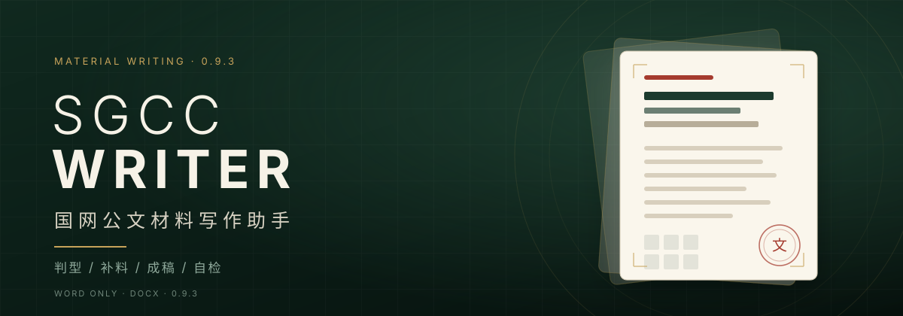

# SGCC Writer

**国网公文材料写作助手**




把"写方案、写汇报、写总结、起草规范、写调研报告"从临时拼凑，变成一套可复用的**判型 → 补料 → 成稿 → 自检**流程。

## 说明


本技能只提供文风、结构、格式、句式与自检规则的指导辅助，不包含任何业务数据、内容指导或事实性材料。

仓库中的数字、单位名称、文号、人名、引文等内容均为演示值或虚构值，不来自任何真实文档，不涉及任何真实业务数据、真实单位、真实人员或真实项目，不作为事实依据。

---

## SGCC Writer是什么

SGCC Writer 是一个面向国网公文场景的智能体技能。它把方案、汇报、总结、规范、报告等常用材料的体例，固化成可执行的写作规则、结构骨架和自检清单；你只需要提供事实与素材，它负责判型、追问、成稿和交付。

它不替你编数据，也不替你做决策。数据、文号、人名、引文、业务提法必须由你提供；它负责把这些内容组织成"像国网材料"的样子，并在交稿前把硬伤挑出来。

## 解决什么问题

- **文风从零开始**：每次都要重新教模型"国网材料怎么写"。技能内置**国网公文文风与风格预置**：章节骨架、四级编号、常用动词与句式、口吻尺度、称谓与命名规则，开箱即用。
- **结构不对**：公文有自己的章节顺序、编号链和口吻，直接让模型自由发挥往往"像作文，不像材料"。
- **内容乱入**：旧材料里的数字、提法、文号、领导讲话被顺手搬到新稿里，造成事实错误。
- **交付不规范**：文件名、版本号、保存位置、占位符没有统一规则，返工成本高。
- **自检靠感觉**：只检查"有没有写"，不检查"数据前后是否一致、时间是否矛盾、称谓是否统一"。

SGCC Writer 把这些问题拆成可执行的规则：**先判型，再补料，按骨架生成，最后按硬伤清单自检。**

---

## 能写什么

| 文体 | 亚型 | 产出 |
|---|---|---|
| 工作方案 | 年度方案、建设专项、落实型、运营方案、思路举措、流程规范 | docx |
| 书面汇报 | 标准回顾型、前瞻举措型、工作总结变体（年度/专项） | docx |
| 标准规范 | GB 企标体、公文通知体、接口规范体、操作手册体 | docx |
| 调研报告 | 现状调研、专题研究、举措研究 | docx |

---

## 有什么特点

### 1. 国网文风预置

内置国网公文的常用写法：`一、→（一）→1.→（1）`四级编号，"以X为Y""坚持X、突出X""从X向Y"等句式骨架，动词十件套，问题表述分寸，保障措施对仗，以及称谓与文件命名规则。不需要每次从零描述风格。

### 2. 判型路由

先判断"这是哪一种材料"，再只加载对应的参考文件。方案、汇报、规范、报告四类各有独立骨架；同一类里再分亚型，避免把所有公文写成同一个样子。

### 3. 引导补料

生成前先问关键信息：主题、对象与场合、时间坐标、篇幅、依据、素材。每批不超过 4 个问题，未回答的项留占位符，不编造事实。

### 4. 规则与内容分离

技能只沉淀**可复用的规则**：体裁骨架、编号链、句式骨架、口吻尺度、命名规则、自检项。
具体内容——业务专名、指标数值、文号、人名、引文、年度、单位、项目——一律由用户或当期文件提供。

### 5. 内容来源清单

生成时同步维护一张清单：`类别 | 内容 | 来源`。
覆盖数字、年份、文号、人名职务、引文、专名、提法、单位/场景。正文里每个事实都要能回溯到用户原话或用户文件，找不到就留占位符。

### 6. 三级交稿自检

- **A 硬伤级**：数字一致、时间一致、称谓一致、引文可溯源、无虚构无残留、对外口吻。任一项不过即返工。
- **B 体例级**：编号链、文体边界、关键句式、问题表述、标题与落款。
- **C 交付级**：文件名、保存位置、交付回复。

其中"上下数据不一致"是重点检查项：同一指标在目标章、任务章、成效处、附件表必须同值同口径；分项之和等于合计；改动一处要全文同步。

### 7. 语感示例隔离

演示用的语感样例放在 `sgcc-writer/examples/语感示例.md`，**默认不读**。只有需要校准句式、节奏、口吻时才读取；样例中的单位、数字、提法、人名、引文等均为演示值，不得复用。

### 8. 交付规范

- 文件名：`【YYYY.MM.DD】主题名称+文种_Vn.n`
- 保存位置：用户指定路径优先；未指定则存工作目录根目录
- 过程文件与交付物分离：中间产物进 `产物/artifacts/`，临时文件进 `产物/tmp/`
- 交付回复包含：绝对路径、字数、占位符数量、内容来源清单

---

## 安装方法

### 把这段话发送给你的智能体

复制下面这段，发给你的智能体即可。它只会安装技能目录，不会把 README、CHANGELOG 放进技能包。

```
帮我安装 SGCC Writer 技能：
仓库：https://github.com/nothingtosayyy/sgcc-writer
只复制仓库中的 sgcc-writer/ 子目录
不要复制 README.md、CHANGELOG.md 和 .github 目录。
安装后确认 SKILL.md 存在，并告诉我安装路径。
```

---

## 更新记录

### 0.9.1（2026-11-05）

首个公开版本。

- 完成规则/内容分离：参考文件中的数字、人名、文号、引文、专名、提法全部占位化。
- 新增"内容来源清单"，覆盖 8 类事实，正文每项可溯源。
- 自检重写为 A 硬伤 / B 体例 / C 交付三级，优先消除数据前后不一致等硬伤。
- 新增"工作总结"变体：全年回顾 → 主要成效 → 存在的问题 → 下一年工作思路。
- 明确能力边界：PPT 剥离，讲话稿移出范围。
- 统一文件命名：`【YYYY.MM.DD】主题+文种_Vn.n`，初稿 V1.0。
- 统一交付路径：用户指定优先，过程文件与交付物分离。
- 新增隔离语感库 `examples/语感示例.md`，默认不读、内容不可复用。
- 示例配置更新为 5 条：方案、汇报、总结、标准、调研报告。

---

## 反馈

- 仓库：<https://github.com/nothingtosayyy/sgcc-writer>
- 问题与建议：请提交 Issue，附上材料类型、期望结构、当前输出差异。

---
